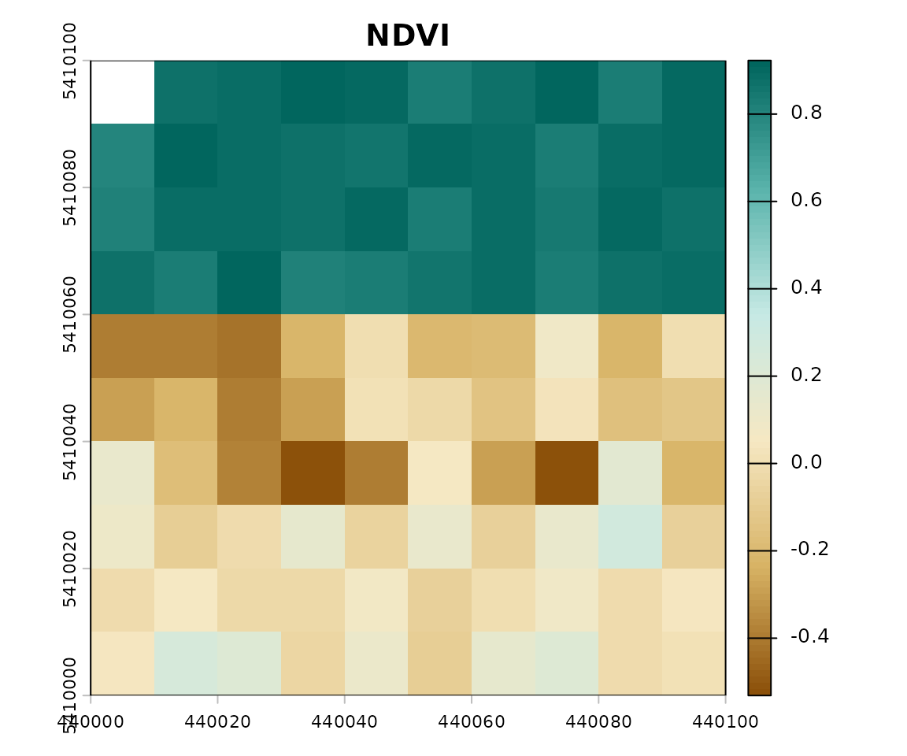

# Introduction to GeoIndexR

## Overview

**GeoIndexR** is a modern, modular, and extensible R package for
computing spectral and geospatial indices from multispectral raster
data. Built natively on `terra`, GeoIndexR operates on `SpatRaster`
objects and file paths while preserving all georeferencing, projection
(CRS), resolution, and spatial extents.

Beyond standard indices, GeoIndexR features a **secure custom formula
engine**
([`geo_index_custom()`](https://sowsalim01.github.io/GeoIndexR/reference/geo_index_custom.md))
enabling users to compute any mathematical expression on spectral bands
with custom constants.

------------------------------------------------------------------------

## 9-Step Complete Workflow

### Step 1: Load a Raster (SpatRaster or File Path)

You can pass a loaded
[`terra::SpatRaster`](https://rspatial.github.io/terra/reference/SpatRaster-class.html)
or directly supply a file path character string:

``` r

library(GeoIndexR)
library(terra)
#> terra 1.9.50

# Load synthetic 6-band multispectral image
img <- get_example_data()
print(img)
#> class       : SpatRaster
#> size        : 10, 10, 6  (nrow, ncol, nlyr)
#> resolution  : 10, 10  (x, y)
#> extent      : 440000, 440100, 5410000, 5410100  (xmin, xmax, ymin, ymax)
#> coord. ref. : WGS 84 / UTM zone 31N (EPSG:32631)
#> source(s)   : memory
#> names       :     blue,    green,      red,      nir,    swir1,    swir2
#> min values  : 0.020222, 0.041241, 0.020295,  0.01032, 0.005001, 0.001065
#> max values  : 0.197477, 0.239128, 0.348968, 0.848912, 0.546913, 0.446534
names(img)
#> [1] "blue"  "green" "red"   "nir"   "swir1" "swir2"
```

### Step 2: Identify and Map Spectral Bands

Bands can be resolved automatically by layer name, by layer position
index (`c(red = 3, nir = 4)`), or using sensor presets
(`sensor = "sentinel2"`):

``` r

# Band mapping by explicit role name
bands_map <- c(red = "red", nir = "nir", blue = "blue")
```

### Step 3: Compute a Standard Predefined Index

Compute standard indices using
[`geo_index()`](https://sowsalim01.github.io/GeoIndexR/reference/geo_index.md):

``` r

ndvi <- geo_index(img, "NDVI", bands = bands_map)
print(ndvi)
#> class       : SpatRaster
#> size        : 10, 10, 1  (nrow, ncol, nlyr)
#> resolution  : 10, 10  (x, y)
#> extent      : 440000, 440100, 5410000, 5410100  (xmin, xmax, ymin, ymax)
#> coord. ref. : WGS 84 / UTM zone 31N (EPSG:32631)
#> source(s)   : memory
#> name        :      NDVI
#> min value   : -0.531245
#> max value   :  0.922703
```

### Step 4: Examine Summary Statistics and Quantiles

Use
[`index_summary()`](https://sowsalim01.github.io/GeoIndexR/reference/index_summary.md)
to compute descriptive statistics including percentiles (q05, q25, q75,
q95) and NA percentages:

``` r

summary_tbl <- index_summary(ndvi)
print(summary_tbl)
#> 
#> === GeoIndexR Spectral Summary ===
#> 
#>  index     min    max   mean median     sd     q05     q25    q75    q95 na_pct
#>   NDVI -0.5312 0.9227 0.2984 0.1108 0.4873 -0.3934 -0.0779 0.8676 0.8994      1
#>  total_cells
#>          100
```

### Step 5: Visualize the Index

Use
[`plot_index()`](https://sowsalim01.github.io/GeoIndexR/reference/plot_index.md)
with thematic color palettes automatically matched to index categories
(vegetation, water, urban, soil, snow):

``` r

plot_index(ndvi, "NDVI")
```



### Step 6: Save the Result to Disk

All outputs from `GeoIndexR` are standard
[`terra::SpatRaster`](https://rspatial.github.io/terra/reference/SpatRaster-class.html)
objects, ready for export:

``` r

writeRaster(ndvi, "NDVI_output.tif", overwrite = TRUE)
```

### Step 7: Compute a Custom Formula Index

Compute your own formulas using
[`geo_index_custom()`](https://sowsalim01.github.io/GeoIndexR/reference/geo_index_custom.md):

``` r

# Compute a custom ratio
custom_ratio <- geo_index_custom(
  img,
  formula = "(nir - red) / (nir + red)",
  bands = c(red = "red", nir = "nir"),
  name = "MyCustomNDVI"
)
print(custom_ratio)
#> class       : SpatRaster
#> size        : 10, 10, 1  (nrow, ncol, nlyr)
#> resolution  : 10, 10  (x, y)
#> extent      : 440000, 440100, 5410000, 5410100  (xmin, xmax, ymin, ymax)
#> coord. ref. : WGS 84 / UTM zone 31N (EPSG:32631)
#> source(s)   : memory
#> name        : MyCustomNDVI
#> min value   :    -0.531245
#> max value   :     0.922703

# Compute a custom parameterized index
custom_veg <- geo_index_custom(
  img,
  formula = "G * (nir - red) / (nir + C1 * red - C2 * blue + L)",
  bands = c(blue = "blue", red = "red", nir = "nir"),
  params = list(G = 2.5, C1 = 6.0, C2 = 7.5, L = 1.0),
  name = "CustomEVI"
)
print(custom_veg)
#> class       : SpatRaster
#> size        : 10, 10, 1  (nrow, ncol, nlyr)
#> resolution  : 10, 10  (x, y)
#> extent      : 440000, 440100, 5410000, 5410100  (xmin, xmax, ymin, ymax)
#> coord. ref. : WGS 84 / UTM zone 31N (EPSG:32631)
#> source(s)   : memory
#> name        : CustomEVI
#> min value   : -0.114944
#> max value   :  1.138812
```

### Step 8: Manage Reflectance and Scale Factors

For scale-sensitive indices (such as EVI, SAVI, MSAVI, ARVI) where input
data are stored as raw integer Digital Numbers (e.g. $`[0, 10000]`$ in
Sentinel-2 L2A), specify `scale_factor = 10000`:

``` r

# Mock integer DN raster
img_dn <- img * 10000

# Calculate EVI with proper scale factor conversion
evi_scaled <- geo_index(
  img_dn,
  "EVI",
  bands = c(blue = "blue", red = "red", nir = "nir"),
  scale_factor = 10000
)
index_summary(evi_scaled)
#> 
#> === GeoIndexR Spectral Summary ===
#> 
#>  index     min    max   mean median     sd     q05     q25    q75    q95 na_pct
#>    EVI -0.1149 1.1388 0.3675 0.0735 0.4623 -0.0779 -0.0333 0.8732 1.0481      1
#>  total_cells
#>          100
```

### Step 9: Consult the Extensible Index Registry

Explore available indices, formulas, required bands, interpretations,
and literature citations via
[`index_registry()`](https://sowsalim01.github.io/GeoIndexR/reference/index_registry.md):

``` r

reg <- index_registry(category = "vegetation")
reg[, c("index", "name", "required_bands", "requires_reflectance")]
#>   index                                         name required_bands
#> 1  NDVI       Normalized Difference Vegetation Index       nir, red
#> 2  SAVI               Soil Adjusted Vegetation Index       nir, red
#> 3   EVI                    Enhanced Vegetation Index nir, red, blue
#> 4 MSAVI    Modified Soil Adjusted Vegetation Index 2       nir, red
#> 5 OSAVI     Optimized Soil-Adjusted Vegetation Index       nir, red
#> 6  ARVI   Atmospherically Resistant Vegetation Index nir, red, blue
#> 7 GNDVI Green Normalized Difference Vegetation Index     nir, green
#>   requires_reflectance
#> 1                FALSE
#> 2                 TRUE
#> 3                 TRUE
#> 4                 TRUE
#> 5                 TRUE
#> 6                 TRUE
#> 7                FALSE
```
